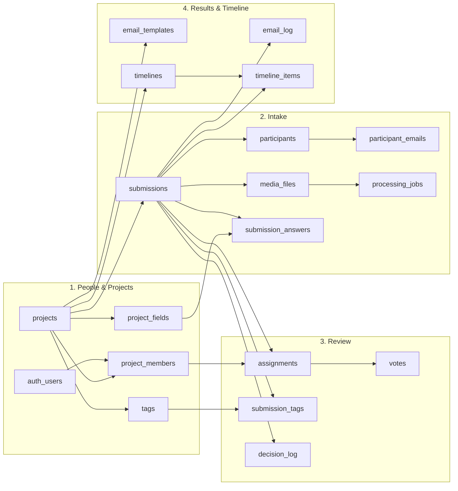
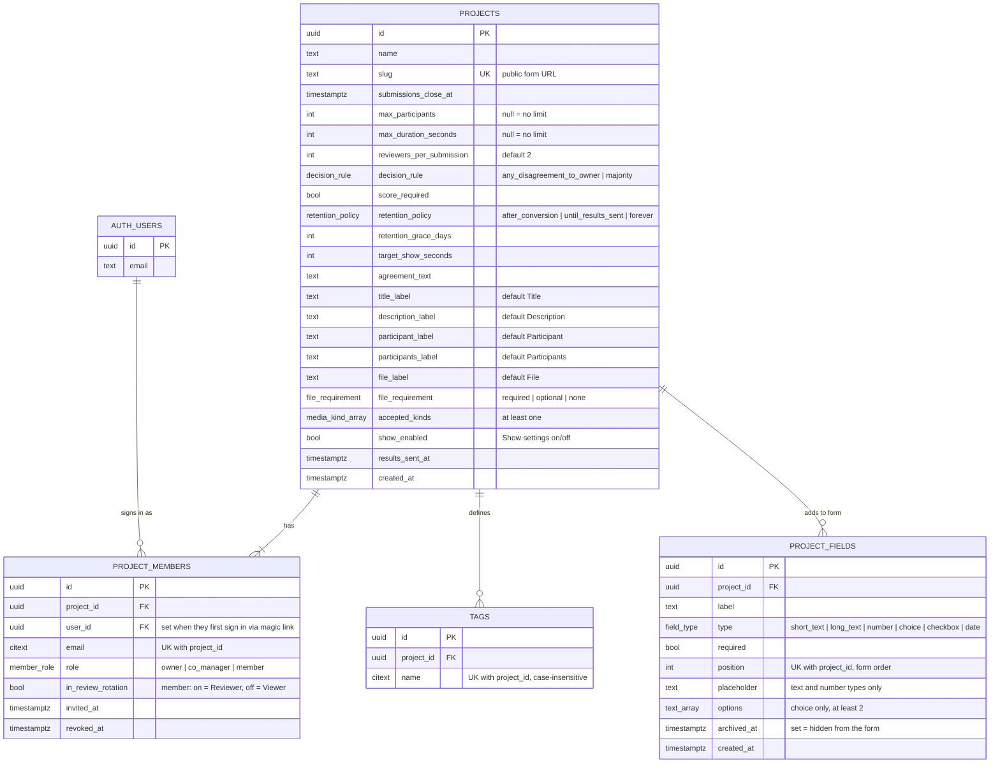
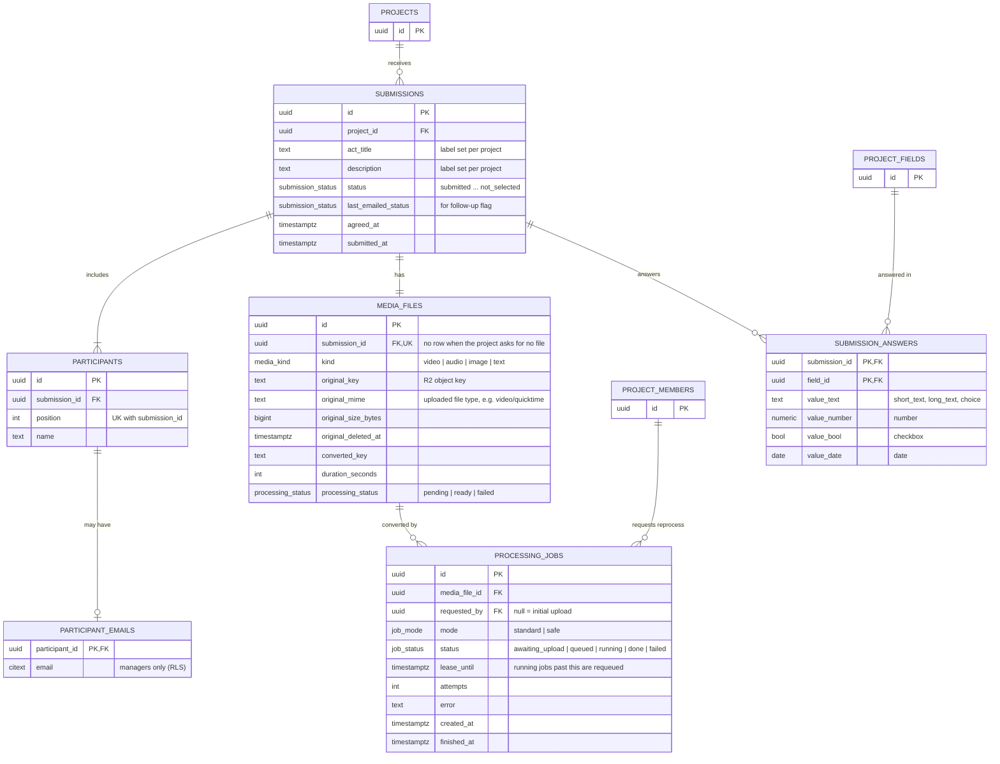
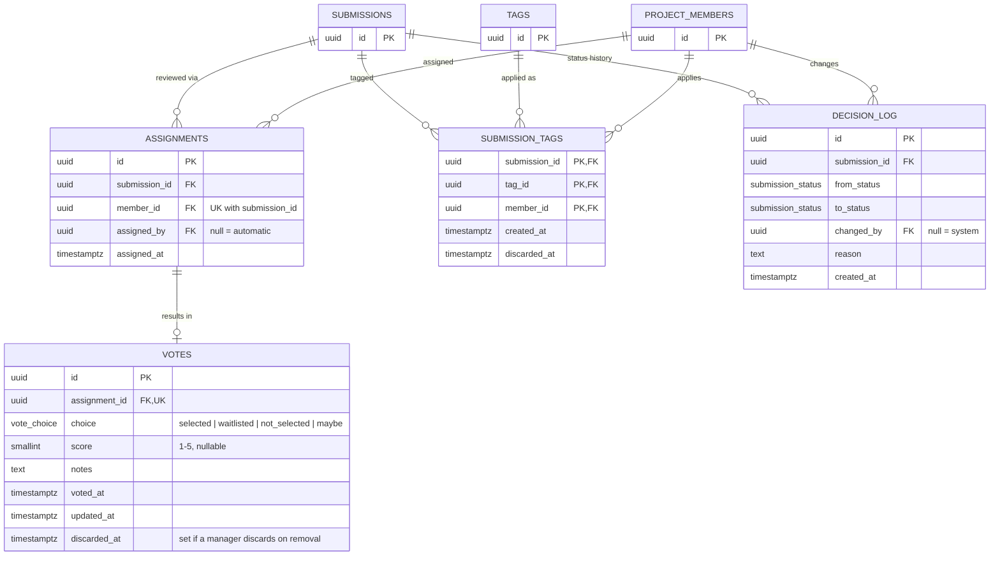
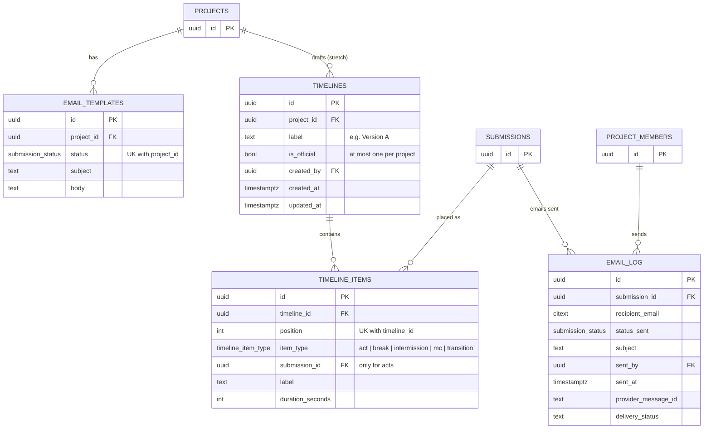

# ChooseTogether ERD (v1)

Postgres on Supabase. `auth.users` is Supabase's built-in user table. Everyone on a team, owners and invited members alike, signs in with a magic link. Their permissions come from `project_members`, matched by email. Performers never sign in.

The schema is split into four areas. The overview shows how they connect, and each section below has the full columns for its tables. Tables from another area appear as small stubs (just `id`) so the links are clear.

## Overview

Arrows point from the parent ("one") to the child ("many").

## 1. People & Projects

## 2. Intake

## 3. Review

## 4. Results & Timeline

## Key constraints and design notes
- **The owner is also a `project_members` row** (role `owner`, with `user_id`). Every permission check uses the same table.
- **Roles vs. reviewing:** `role` sets permissions (`owner`, `co_manager`, `member`). `in_review_rotation` decides who gets auto-assigned. The UI labels a `member` as **Reviewer** (on) or **Viewer** (off). Managers can turn it on for themselves (default off), and members default to on. This avoids contradictory states like a "viewer" who has assignments.
- **One owner per project:** a partial unique index on `project_members(project_id) WHERE role = 'owner'`.
- **One open processing job per file:** a partial unique index on `processing_jobs(media_file_id) WHERE status IN ('awaiting_upload','queued','running')`.
- **Job lifecycle:** `awaiting_upload` (created at submit) → `queued` (upload complete) → `running` (claimed by Lambda) → `done` or `failed`. The sweep only touches `queued` and `running`, so it never sends Lambda after a file that hasn't finished uploading.
- **No duplicate reviewers:** `UNIQUE(submission_id, member_id)` on `assignments`.
- **One vote per assignment:** `UNIQUE(assignment_id)` on `votes`. Votes hang off assignments, so a demoted reviewer's completed votes survive.
- **Votes are editable** (updates `updated_at`) until a manager sets the submission's final status. After that they're read-only. There's no vote history table.
- **Conflict check:** assignment skips a member whose `email` matches any `participant_emails.email` on that submission.
- **At least one participant email:** enforced by the submit Edge Function (in one transaction) and in the browser.
- **Finality of participants:** triggers block updates to `participants` and `participant_emails`, and RLS blocks all browser writes. Adding new participant rows to an existing submission is prevented only by the submit function being the sole writer (the database doesn't block a later insert by server code).
- **Flexible forms:** every project has the same core fields on `submissions` (title, description, participants, optional file), with labels set per project. Anything else is a `project_fields` row, and answers are typed rows in `submission_answers`, so the data stays relational.
  - Exactly one value column is filled per answer, and a trigger checks it matches the field's type and project, and that a choice answer is one of the options.
  - Answers are final (no updates). A field's type never changes, options with answers can only be added to, and a field with answers can't be deleted (foreign key), only hidden with `archived_at`.
  - Required custom fields are checked by the submit Edge Function and in the browser, like the participant email rule.
- **Combined tags:** `SELECT DISTINCT tag_id FROM submission_tags WHERE submission_id = ? AND discarded_at IS NULL`.
- **Decision log is append-only.** Every change to `submissions.status` inserts a row, ideally from a trigger.
- **Follow-up flag:** `status <> last_emailed_status` after results are sent.
- **Privacy:** participant emails live in their own 1-to-1 table, `participant_emails`, whose RLS policy allows only managers to read it. Reviewers and viewers can read `participants` (names) but get no rows from `participant_emails`. A participant without an email has no row there.
- **Removing a member** is soft: set `revoked_at`, so their invite link stops working, and their unfinished assignments are reassigned. The manager chooses whether to **keep or discard** their completed votes and tags.
  - Discarding sets `discarded_at` instead of deleting, so history stays intact.
  - Discarded votes and tags don't count toward decisions or combined tags.
  - Affected submissions get a replacement reviewer to fill the missing vote.
- **Timeline drafts:** a project can have many labeled `timelines`. At most one is marked official (partial unique index on `timelines(project_id) WHERE is_official`), and that's the one the team sees by default. An act appears at most once per timeline (`UNIQUE(timeline_id, submission_id)`).
- `citext` is a case-insensitive text type, so `Sam@x.com` = `sam@x.com`.
