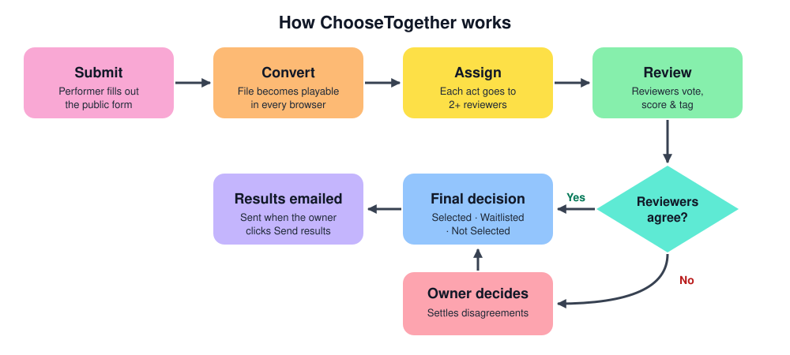
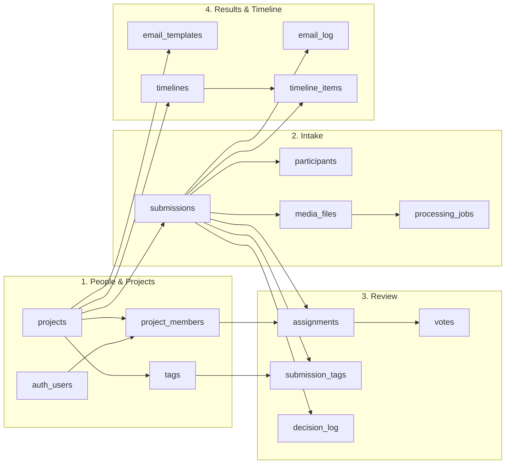
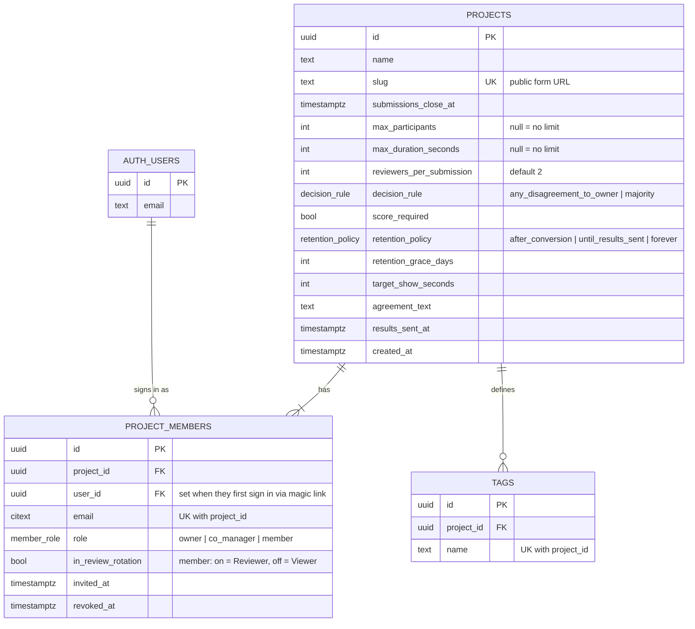
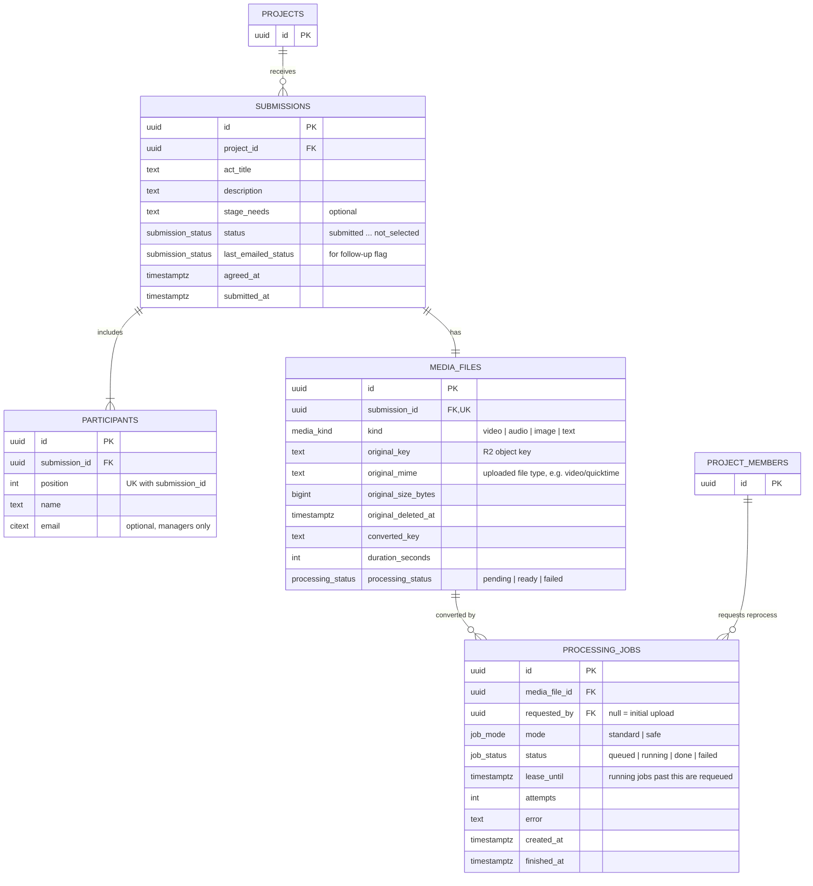
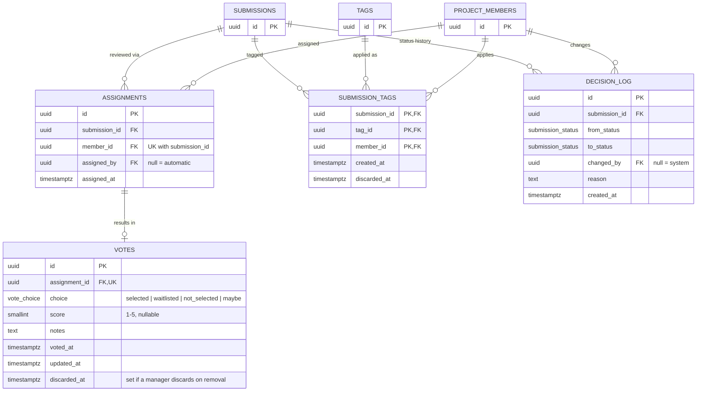
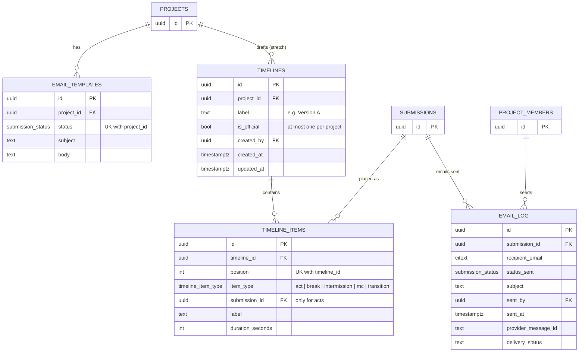
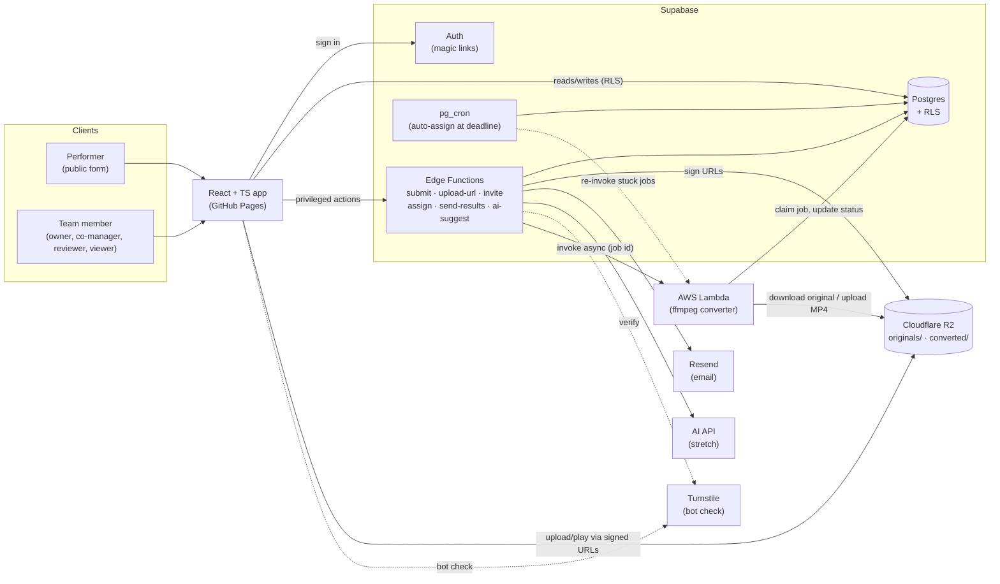
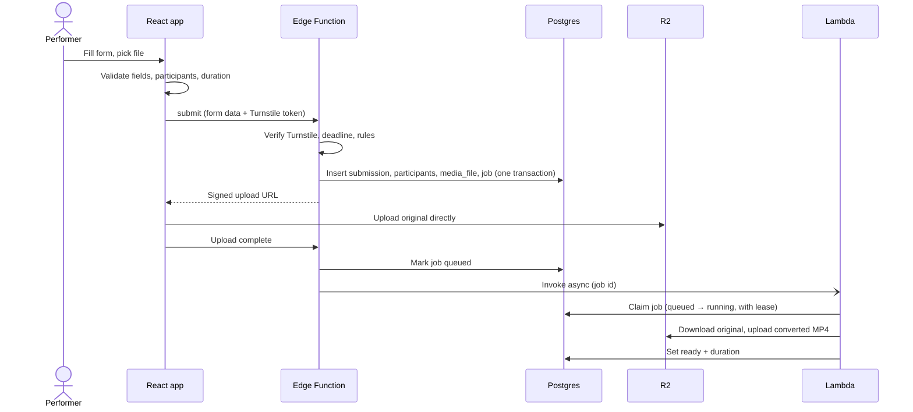

# ChooseTogether: Initial Design

> This is the original design from 11/19. For the current schema, see [erd.md](erd.md) and the migrations in `supabase/migrations/`.

## Purpose and Goals

I am creating ChooseTogether to help my Stake Activities Committee retrieve and review hundreds of submissions for a talent show in January. Though it solves a specific problem, I am making it as extensible as I can by adding support for other file types, creation of new projects, and project-by-project settings to meet the needs of potential users. Important features include creating projects, inviting reviewers, the submission form, deciding whether to include a submission based on the reviewers' votes, and sending emails to those who submitted. 

I hope to have it mostly functioning by the time of my demo so I can start using it with the committee. I am considering adding the ability to create timelines of the accepted submissions and possibly integrating AI suggestions based on the reviewers' feedback, but this will be a stretch goal.

## Initial ERD

Postgres on Supabase. Everyone on a team signs in with a magic link, and their permissions come from `project_members`. Performers never sign in. Full notes are in [erd.md](erd.md).

### Overview

Arrows point from the parent ("one") to the child ("many").

### 1. People & Projects

### 2. Intake

### 3. Review

### 4. Results & Timeline

## System Design

Full details (security boundaries, scaling, concurrency, failover, costs) are in [system_design.md](system_design.md).

### Architecture

### Submission flow

## Daily Goals

Milestones: **form ready by Thu 12/3**, form opens about Sat 12/5, final submission Thu 12/10.

| Date | Goal |
|---|---|
| Thu 11/19 | Initial design, data modeling + system design interviews, project log entry |
| Fri 11/20 | Set up the Supabase project, Vite React + TS app, R2 bucket, repo structure, GitHub Pages deploy workflow |
| Sat 11/21 | Write the database schema for People & Projects and Intake, with basic RLS |
| Mon 11/23 | (Class work day) Owner magic-link sign-in, create project + settings screen |
| Tue 11/24 | Invite Edge Function: add members by email and role, send the magic link |
| Wed 11/25 | Public submission form UI: fields, participants add/remove, duration check |
| Thu 11/26 – Fri 11/27 | Thanksgiving (light or off) |
| Sat 11/28 | Submit Edge Function: one-transaction insert, signed R2 upload, Turnstile |
| Mon 11/30 | (Class) AWS Lambda ffmpeg converter and job claiming |
| Tue 12/1 | pg_cron sweep for stuck jobs, end-to-end test (upload → ready) on the live GitHub Pages site |
| Wed 12/2 | (Class) Test with real phone videos from several browsers, fix bugs |
| Thu 12/3 | **Intake freeze:** form ready to go live |
| Fri 12/4 | Review schema + auto-assignment with conflict check |
| Sat 12/5 | **Form opens.** Review queue/list with vote, score and tags |
| Mon 12/7 | (Class) Decision rule trigger, statuses, decision log, team results view |
| Tue 12/8 | **Demo-ready build:** record the demo video/GIF, prepare presentation slides. Email templates + Send results only if time allows |
| Wed 12/9 | (Last class) **In-class presentation**, collaboration, polish |
| Thu 12/10 | Final submission and class-channel post |
