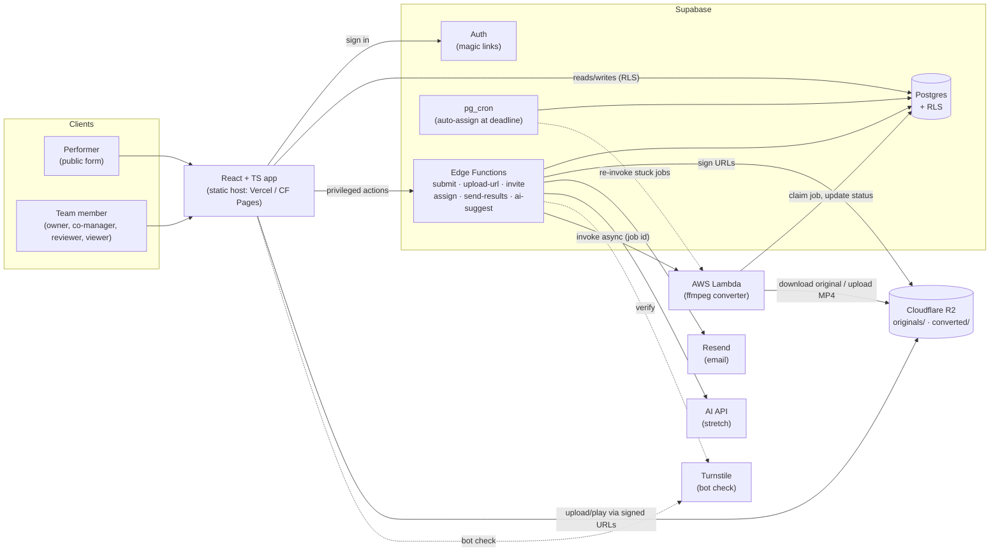
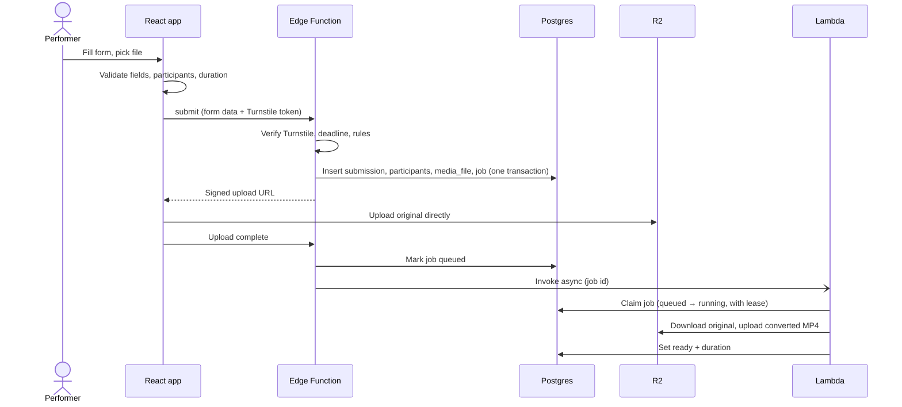

# ChooseTogether System Design (draft v1)

## Architecture

## Main flows

### Submitting (public)

### Inviting and signing in
1. A manager adds an email and role. The `invite` Edge Function inserts the `project_members` row and has Supabase Auth email a magic link.
2. The member clicks the link and gets a Supabase session, with no password.
3. RLS matches the session's email to `project_members` rows to decide access. A revoked row (`revoked_at`) is denied even with a valid session.

### Reviewing
1. The team member opens the app and is signed in through Supabase Auth.
2. RLS returns only their project's data, with participant emails hidden from non-managers.
3. For playback, an Edge Function returns a **short-lived signed URL** for the converted file. Videos are never public.
4. Votes and tags are written directly to Postgres under RLS. A trigger recomputes the submission status under the decision rule and writes the decision log.

## Security boundaries
| Zone | Who | Can do |
|---|---|---|
| Public | Anyone with the form link | Submit only, through an Edge Function that checks Turnstile, the deadline and the rules. No direct table access. |
| Team | Signed-in members | RLS-scoped reads/writes for their own projects. Role checks for manager actions. Emails hidden from non-managers. |
| Server-only | Edge Functions, Lambda | Service-role DB key, R2 keys, Resend key, AI key, AWS invoke credentials (scoped to invoking only this function). Never sent to the browser. |
| Storage | R2 | Private bucket. All access goes through short-lived signed URLs. |

## Scaling and performance
- **Database load is tiny**: 300 submissions and about 10 reviewers. Add indexes on the foreign keys plus `(project_id, status)`.
- **Video conversion is the heavy part, and Lambda handles it by scaling out.**
  - Each upload gets its own Lambda invocation, so conversions run **in parallel and continuously** as submissions arrive. A last-minute rush of 50 videos converts at the same time instead of one after another.
  - Settings: `-preset medium` at CRF 20, with high memory (more CPU) to stay well under the 15-minute limit.
  - Lambda's account concurrency limit can be lowered on purpose to cap cost.
- Uploads go straight to R2, so large files never load the app's server.

## Concurrency
- **Claiming jobs:** a Lambda claims its job with a conditional update (`UPDATE … SET status='running', lease_until=… WHERE id=? AND status='queued'`). If AWS retries or delivers an invocation twice, only one copy wins and the other exits. A partial unique index allows only one open job per file.
- **Stuck jobs:** a job `running` past its lease (e.g. 20 minutes) is requeued and re-invoked by the pg_cron sweep, so a crashed or timed-out run doesn't block it forever. After a few attempts it's marked `failed`.
- **Assignment:** runs in one transaction with `UNIQUE(submission_id, member_id)`, so a double-click or cron overlap can't double-assign.
- **Decisions:** two managers changing a status at the same time both get logged, and the last write wins. An optimistic check (`WHERE status = <expected>`) can warn the second manager.

## Failover and reliability
- R2 and Supabase are managed services, so there are no servers to fail over.
- **Free Supabase projects pause after about a week of inactivity**, and the free tier has limited backups. Run a scheduled `pg_dump` backup and keep the project active during the show period.
- If Lambda invocation fails, submissions still succeed and wait as `queued`, and the sweep retries them.
- Emails are logged with the provider's message ID, so failed sends can be found and retried.

## Costs (approximate; check current free tiers)
| Service | Expected cost |
|---|---|
| Supabase (DB, Auth, Edge Functions) | Free tier |
| Frontend hosting | Free tier |
| Cloudflare R2 | ~10 GB free. 150+ GB with originals is about $2–3/month during the show, less after retention cleanup |
| Resend | Free tier (daily limit; ~300–900 emails could take more than one day) |
| Turnstile | Free |
| AWS Lambda | Possibly within the always-free allowance (~400k GB-s/month). Estimate ~450k–600k GB-s for 300 videos, so maybe a couple of dollars over. Outbound data (~60–90 GB) fits AWS's 100 GB/month free. Check the current free-tier terms for your account. |
| AI API (stretch) | Cents per suggestion run |

## New technologies (flagged per AGENTS.md)
Supabase (Auth, RLS, Edge Functions on Deno, pg_cron), Cloudflare R2 + signed URLs, ffmpeg, AWS Lambda with an ffmpeg layer or container image, Resend, Cloudflare Turnstile, Vite, and a static host.
